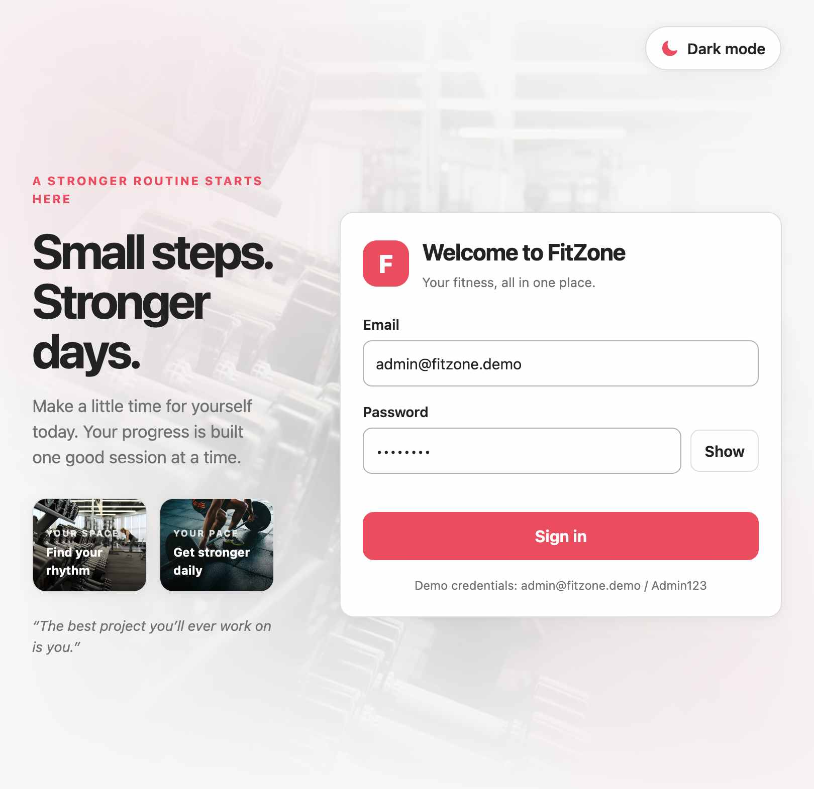
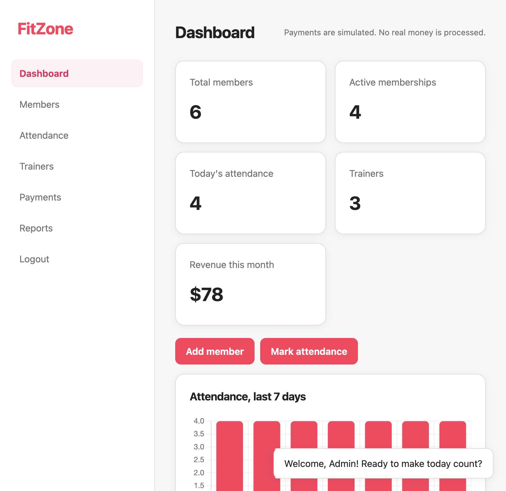
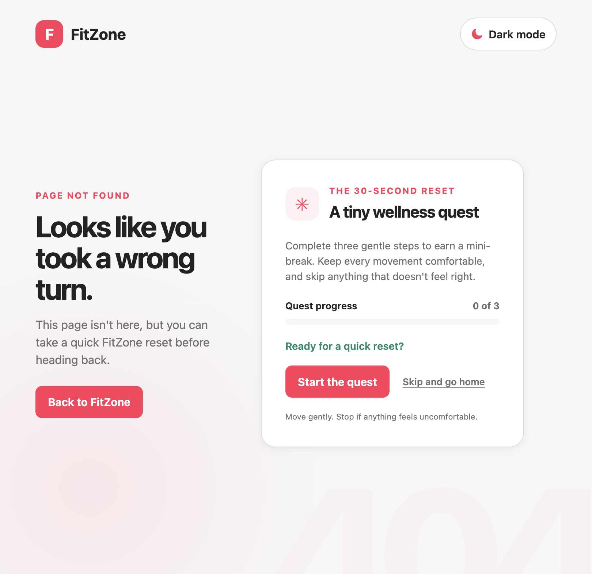

# FitZone

A responsive fitness-center management demo built with HTML, CSS, and vanilla JavaScript. It includes member and trainer records, attendance, simulated payments, reports, charts, a saved light/dark theme, and a small wellness quest on the custom 404 page.

> **Demo only:** Authentication is hard-coded for demonstration, records are stored in this browser's `localStorage`, and payments are simulated. Do not use real credentials, personal information, or payment details.

## Screenshots

### Login



### Dashboard



### Custom 404 and wellness quest



## Features

- Demo sign-in and password visibility toggle
- Responsive dashboard with membership, attendance, trainer, and revenue summaries
- Searchable member, trainer, attendance, and payment records
- Add, edit, and delete flows with input validation
- Member status and payment filters
- Attendance and monthly revenue charts
- CSV exports and a printable report
- Light/dark theme preference saved in local storage
- Responsive custom 404 page with a replayable, three-step wellness quest

## Run locally

The app uses JavaScript modules and loads its HTML components with `fetch`, so run it from a local web server rather than opening `index.html` directly.

```sh
python3 -m http.server 8000
```

Open [http://localhost:8000](http://localhost:8000) in your browser.

### Demo sign-in

- **Email:** `admin@fitzone.demo`
- **Password:** `Admin123`

## Project structure

```text
.
├── 404.html
├── assets/
│   ├── css/             # Base, layout, component, responsive, and 404 styles
│   └── images/          # Gym and strength-training photos
├── components/          # HTML partials loaded by the app
├── docs/
│   └── screenshots/     # README screenshots
├── index.html
└── js/                  # App, data, auth, dashboard, records, reports
```

## Notes

- Chart.js is loaded from jsDelivr, so dashboard charts require an internet connection.
- Configure your hosting provider to serve `404.html` for unknown paths if you want the custom not-found page to appear automatically.
